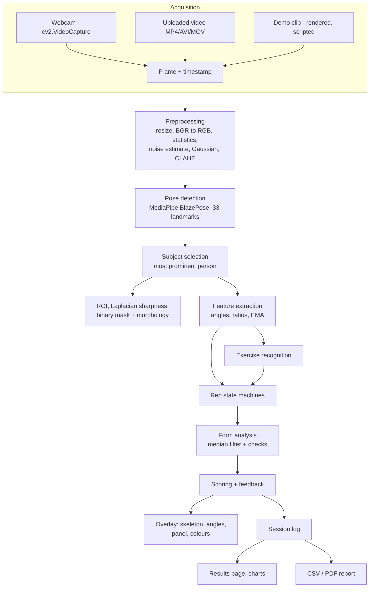
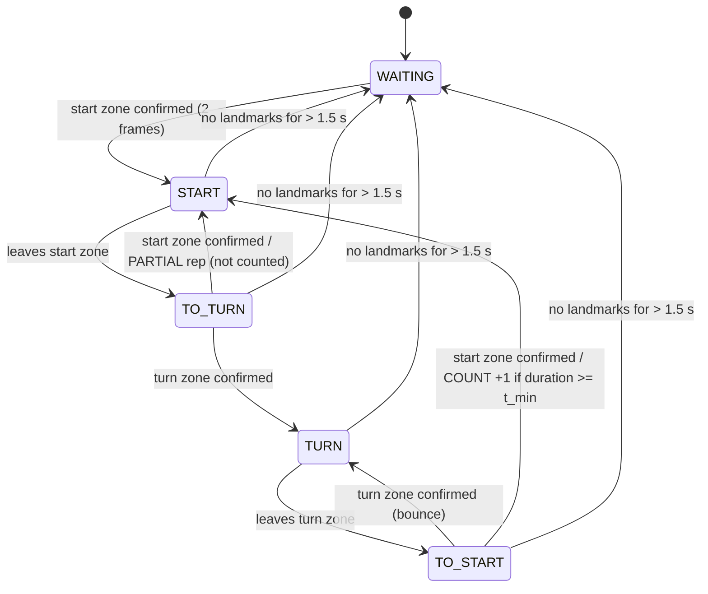

# AI-Based Gym Exercise Form Analyzer — Project Documentation

*Digital Image Processing course project. Material for the report and presentation.*

---

## 1. Introduction

Strength training is effective only when exercises are performed with controlled, full-range
movement and a stable posture. A coach judges form by watching the geometry of the body: how
deep the knees bend, whether the back stays upright, whether the elbows stay still. This project
makes that judgement automatically from video. Classical digital image processing prepares each
frame, a pretrained pose-estimation network locates the body joints, and geometric analysis
turns the joint positions into repetition counts, form feedback and a score.

## 2. Motivation

* Many people train alone at home or in gyms without supervision.
* Wearable sensors cost money and must be worn. A camera is already built into every laptop.
* Modern lightweight pose models run in real time on a CPU, so the system can run on a student
  laptop.
* The problem is a good showcase for DIP. Real-world footage is dark, noisy, blurred and
  cluttered, and preprocessing measurably changes whether the person can be found at all
  (Section 18.3).

## 3. Problem Statement

Given a video stream of a single person exercising, determine automatically:

1. **what** exercise is performed (squat, bicep curl, push-up, shoulder press),
2. **how many** repetitions were completed,
3. **how well** each repetition was performed, expressed as specific geometric deviations and
   a transparent 0–100 score,

in real time, on a CPU, robustly to noise, missing body parts, poor lighting and extra people.

## 4. Existing System

| Approach | Drawbacks |
|---|---|
| Personal trainer | expensive, not always available |
| Mirrors / self-recording | the user must judge their own form; no measurement |
| Wearable IMU sensors / smart equipment | extra hardware and cost; one device per body part |
| Rep-counter phone apps | usually count only (often by simple threshold crossing, which is noise-prone), with no explanation of form |
| Research systems (e.g. pose-based posture correction) | often offline, one exercise, or need a GPU |

## 5. Proposed System

A camera-only, CPU-only application that:

* preprocesses frames adaptively (measure → decide → enhance),
* detects 33 body landmarks with MediaPipe BlazePose,
* computes scale-invariant geometric features,
* recognises the exercise from geometry, with a manual override,
* counts reps with a noise-tolerant hysteresis state machine,
* scores each rep with explainable, configurable rules,
* shows real-time colour-coded feedback and exports CSV/PDF reports,
* includes a demo mode with ground-truth clips so it can be demonstrated and validated without
  a camera.

## 6. Objectives

1. Implement a clearly staged DIP + computer-vision pipeline.
2. Compute joint angles with a single reusable function.
3. Recognise four exercises automatically.
4. Count repetitions without false counts from jitter.
5. Detect and describe form deviations.
6. Produce a transparent score with a per-rule breakdown.
7. Run in real time on a CPU with useful error handling.
8. Validate quantitatively (unit tests, ground-truth clips, preprocessing experiment).

## 7. Methodology

The project was built stage by stage, each stage with its own module and tests:

1. Environment inspection (Python 3.14, Windows 11, CPU, webcam at index 0).
2. Preprocessing → 3. Pose detection → 4. Geometry → 5. Exercise definitions →
6. Rep state machine → 7. Form analysis → 8. Scoring → 9. UI → 10. Video processing →
11. Demo mode → 12. Export → 13. Tests → 14. End-to-end runs and fixes.

The demo clips were also used to **calibrate and verify** the system. Landmark accuracy was
measured against the scripted joint angles (mean absolute error: knee 1.3–3.7°, torso
0.7–2.9°, elbow 2–12°), and thresholds were set so that "bad" demo reps are *counted but
penalised* with a safe margin, rather than sitting on a threshold.

## 8. System Architecture



### Processing pipeline (per frame)


## 9. Image Acquisition

* **Webcam:** `cv2.VideoCapture(index, CAP_DSHOW)` on Windows, falling back to the default
  backend. The first frame is test-read, and a clear message is shown if the camera is missing,
  busy or blocked by privacy settings. Timestamps come from a monotonic clock.
* **Video file:** validated (opens, first frame decodes) before processing. Timestamps are
  `frame_index / fps`, so results do not depend on computer speed. An optional frame skip
  (every *n*-th frame) trades accuracy for speed.
* **Output:** annotated frames are written as VP8 WebM (plays in the browser), with MP4 as a
  fallback.

## 10. Preprocessing

Each operation is **adaptive**: the frame is measured and enhanced only when needed.

### 10.1 Resizing (geometric transformation)
Frames wider than *W*max = 640 px are scaled by *s* = *W*max / *W* with area interpolation. Each
output pixel is the average of the source pixels it covers, which acts as a low-pass
anti-aliasing filter. The cost of pose inference falls roughly with pixel count.

### 10.2 Colour-space conversions
* BGR → RGB, because OpenCV stores BGR and the pose model expects RGB.
* BGR → grey (luma) for statistics: *Y* = 0.299 *R* + 0.587 *G* + 0.114 *B*.
* BGR → CIELAB, so contrast can be enhanced on lightness *L\** only, preserving hue.

### 10.3 Lighting analysis (histogram statistics on the ROI)
On the subject's region of interest (from the previous frame's landmarks):

  brightness μ = (1/N) Σ I(x,y),  contrast σ = √( (1/N) Σ (I(x,y) − μ)² )

Poor lighting means μ < 70 or σ < 30 (grey levels 0–255).

### 10.4 Noise estimation (Immerkær, 1996)
Convolve the grey image with the mask

```
N = [ 1 -2  1
     -2  4 -2
      1 -2  1 ]
```

(the difference of two Laplacians, which cancels image structure), then

  σ̂ = √(π/2) · 1 / (6 (W−2)(H−2)) · Σ | (I ∗ N)(x,y) |

### 10.5 Gaussian denoising (spatial low-pass filtering)
If σ̂ exceeds a threshold (4, or 1.5 when CLAHE is about to be applied), a 5×5 Gaussian kernel

  G(x,y) = (1 / 2πσ²) · exp( −(x² + y²) / 2σ² )

is convolved with the image. Denoising runs **before** CLAHE because histogram equalisation
amplifies noise along with contrast. In very dark frames the noise is also under-estimated,
because pixel values clip at 0. The experiment in §18.3 shows that this ordering is what
recovers dark, noisy frames.

### 10.6 CLAHE (contrast enhancement)
Histogram equalisation maps grey level *r* to s = T(r) = (L−1) Σ_{j≤r} p(j), where *p* is the
normalised histogram, so the output histogram is spread over the full range. CLAHE
(Zuiderveld, 1994) does this per 8×8 tile, clips each tile's histogram at a limit (2.5) to limit
noise amplification, redistributes the clipped excess, and bilinearly interpolates between tile
mappings to avoid block edges. It is applied to the *L\** channel only when lighting is poor.

**Input → output of the stage:** raw BGR frame → processed BGR frame for display, RGB for the
model, plus measurements (brightness, contrast, σ̂) and the list of operations applied.

## 11. Pose Detection

MediaPipe Pose Landmarker (BlazePose, *lite* model, 5.8 MB) runs in two steps. A detector
locates the person, and a regression network predicts 33 landmarks (normalised *x*, *y*, relative
depth *z*, and a visibility score). In VIDEO mode the landmarks of one frame seed the region
searched in the next, which is faster and temporally more stable.

**Landmarks used:** shoulders (11, 12), elbows (13, 14), wrists (15, 16), hips (23, 24), knees (25, 26),
ankles (27, 28), heels (29, 30), foot index (31, 32). Normalised coordinates are converted to
pixels: *x*px = *x* · *W*, *y*px = *y* · *H*.

**Multiple people:** up to 2 people are detected. The analysed person maximises

  prominence = (width × height of the visible-landmark bounding box) × mean visibility,

and a warning explains that the system is designed for one subject. Landmarks from different
people are never combined.

**Missing landmarks:** a landmark with visibility < 0.5 is treated as missing. Any feature that
needs it becomes *unknown* (`None`) instead of being guessed.

**Post-detection DIP on the subject:** the ROI is the landmark bounding box padded by 15 %.
Sharpness is the variance of the Laplacian inside the ROI. The segmentation probability map is
thresholded at 0.5 into a binary mask, and cleaned with morphological opening
(A ∘ B = (A ⊖ B) ⊕ B, which removes specks) and closing (A • B = (A ⊕ B) ⊖ B, which fills holes).
This mask drives the optional background suppression.

## 12. Feature Extraction

All features use pixel coordinates (*x* right, *y* down).

| Feature | Definition | Used by |
|---|---|---|
| knee_angle | ∠(hip, knee, ankle) | squat rep signal, depth |
| hip_angle | ∠(shoulder, hip, knee) | display |
| ankle_angle | ∠(knee, ankle, foot index) | statistics |
| elbow_angle | ∠(shoulder, elbow, wrist) | curl/push-up/press rep signal |
| shoulder_angle | ∠(hip, shoulder, elbow) | display |
| torso_inclination | angle of hip→shoulder from vertical-up | back angle, lean-back, torso swing |
| body_inclination | angle of ankle→shoulder from vertical-up | recognition (horizontal body) |
| upper_arm_elevation | angle of shoulder→elbow from vertical-down | curl elbow stability |
| forearm_from_vertical | angle of elbow→wrist from vertical-up | press wrist stacking |
| body_line_angle | ∠(shoulder, hip, ankle) | statistics |
| hip_line_offset | signed distance of hip from shoulder–ankle line / line length | push-up sag / pike |
| wrist_above_shoulder | (y_shoulder − y_wrist) / torso length | recognition |
| hip_above_knee | (y_knee − y_hip) / thigh length | statistics |
| knee_over_toe | (x_knee − x_toe) · facing / shin length | squat knee tracking |
| knee_width_ratio | \|x_lknee − x_rknee\| / \|x_lankle − x_rankle\| (front view) | squat knee alignment |

**Normalisation:** distances are divided by a body-segment length, so features do not depend on
distance to the camera or body size.

**Side and view:** the side (left or right) with higher smoothed visibility of shoulder, elbow,
wrist, hip, knee and ankle is analysed. It switches only if the other side is better by more
than 0.15 (hysteresis). The view is "front" if shoulder width / torso length > 0.45.

**Temporal smoothing (EMA):** y_t = α x_t + (1 − α) y_{t−1}, with α = 0.5. This is a first-order
IIR low-pass filter that reduces landmark jitter.

## 13. Joint Angle Calculation

Let the joint be **B**(x₂, y₂), with neighbouring points **A**(x₁, y₁) and **C**(x₃, y₃).

Vectors from the joint:

  **BA** = (x₁ − x₂, y₁ − y₂),  **BC** = (x₃ − x₂, y₃ − y₂)

Dot product and magnitudes:

  **BA** · **BC** = (x₁ − x₂)(x₃ − x₂) + (y₁ − y₂)(y₃ − y₂)

  |**BA**| = √((x₁ − x₂)² + (y₁ − y₂)²),  |**BC**| = √((x₃ − x₂)² + (y₃ − y₂)²)

Angle:

  **θ = arccos( (BA · BC) / (|BA| · |BC|) )**,  θ ∈ [0°, 180°]

Implementation details (`core/angle_calculator.py`, `calculate_angle(point_a, point_b, point_c)`):

* the cosine is clipped to [−1, 1] before `arccos`, to guard against floating-point overshoot;
* if |BA|·|BC| = 0 the angle is undefined and a `ValueError` is raised, and the feature becomes
  unknown.

**Worked example:** hip A(50, 350), knee B(150, 350), ankle C(100, 450).
BA = (−100, 0), BC = (−50, 100); BA·BC = 5000; |BA| = 100, |BC| = 111.8;
θ = arccos(5000 / 11180) = arccos(0.447) ≈ **63.4°** (a deep squat).

**Segment inclination** uses the same function with a vertical reference point:
inclination(P→Q) = ∠(P + (0, −1), P, Q). It is 0° for a segment pointing straight up.

**Signed distance from a line** (push-up hip sag), for point P and line A→B:

  d = [ (x_B − x_A)(y_P − y_A) − (y_B − y_A)(x_P − x_A) ] / |AB|²,

oriented so that positive means P lies below the line (larger y).

## 14. Exercise Recognition

Over a sliding window of T = 2 s of features:

* orientation o = median(body_inclination), falling back to torso inclination, and to "upright"
  for upper-body framing;
* ROM(f) = P95(f) − P5(f), a range of motion robust to outliers;
* h = median(wrist_above_shoulder).

With ramp(x; a, b) = clip((x − a)/(b − a), 0, 1):

| Score | Formula |
|---|---|
| horizontal | ramp(o; 35°, 65°) |
| knee | ramp(ROM(knee); 15°, 40°) |
| elbow | ramp(ROM(elbow); 15°, 40°) |
| hands | ramp(h; −0.1, 0.2) |
| push-up | horizontal · max(elbow, 0.6) |
| squat | (1 − horizontal) · knee |
| shoulder press | (1 − horizontal) · elbow · hands · (1 − knee) |
| bicep curl | (1 − horizontal) · elbow · (1 − hands) · (1 − knee) |

The products act as a fuzzy AND. The label is the arg-max if it scores ≥ 0.5, otherwise
"unknown". The final label needs a strict majority of the last 15 frame votes. It is **sticky**:
resting (no movement → unknown) keeps the last exercise, and only another known exercise can
replace it. MANUAL SELECTION bypasses recognition. Both modes are labelled in the UI.

## 15. Repetition Detection

The rep signal x(t) is the exercise's driving angle. There are two zones:

* start zone: x ≥ θ_ext (for exercises that start extended),
* turn zone: x ≤ θ_flex, with θ_flex < θ_ext.



**Why this does not over-count:**

* **Hysteresis:** noise of amplitude < (θ_ext − θ_flex)/2 around either threshold can never
  complete the start → turn → start cycle. A single-threshold counter would count every
  crossing.
* **Debouncing:** zone entry must persist for 2 consecutive frames.
* **Ordering:** a count requires visiting the turn zone. Starting mid-rep does not count.
* **Minimum duration:** reps faster than 0.6 s are rejected as noise.
* **Missing data:** short gaps hold the state; gaps longer than 1.5 s abandon the rep, so two
  halves are never stitched together.
* **Partial reps:** leaving the start zone by more than 15° and returning without reaching the
  turn zone produces a "partial rep, not counted" message.

| Exercise | Signal | θ_ext | θ_flex | Starts | Phases |
|---|---|---|---|---|---|
| Squat | knee angle | 160° | 125° | extended | STANDING → DESCENDING → BOTTOM → ASCENDING |
| Bicep curl | elbow angle | 130° | 90° | extended | ARM EXTENDED → CURLING → TOP → LOWERING |
| Push-up | elbow angle | 145° | 120° | extended | TOP → LOWERING → BOTTOM → PUSHING UP |
| Shoulder press | elbow angle | 135° | 110° | flexed | RACK → PRESSING → LOCKOUT → LOWERING |

The counting thresholds are deliberately more lenient than the scoring ideals: a shallow squat
is *counted but scored low* ("go deeper"), rather than silently ignored.

## 16. Form Analysis

For each rep, the frames of the rep window (up to 2 s resting in the start position plus the
movement itself) are collected. For each check:

1. take the series of the check's feature, ignoring unknown frames;
2. apply a running **median filter** (window 5), which removes impulse noise (one-frame
   landmark errors) while preserving the plateaus at the top and bottom of the movement;
3. reduce the series: **min** (e.g. depth), **max** (e.g. lean) or **range** (e.g. torso swing);
4. score the value (§17). Scores below 75 add a feedback message that states the measured
   deviation, e.g. *"Go deeper: knee angle only reached 121 deg"*.

Posture checks (back angle, knee tracking, hip sag/pike, elbow stability, back arch, wrist
stacking) are also evaluated on **every frame** for immediate colouring. Range-of-motion checks
can only be judged when the rep ends.

## 17. Scoring

**Check score.** With the configured pair (ideal, zero):

  s(v) = 100 · clip( (v − zero) / (ideal − zero), 0, 1 )

Examples: squat depth (ideal 95°, zero 140°) gives v = 118° → s = 100 · (140 − 118)/45 = 48.9.
Press lockout (ideal 165°, zero 135°) gives v = 160° → s = 83.3. The sign of (ideal − zero)
makes one formula work for both "smaller is better" and "larger is better".

**Rep score.** S = Σᵢ wᵢ sᵢ / Σᵢ wᵢ over the checks that could be measured. The primary range
check has weight 1.5, tempo 0.5, and the others 1.0.

**Session score.** The mean of the rep scores. Best and worst reps and per-check averages
(the breakdown) are also reported.

| Score | Band | Colour |
|---|---|---|
| 100 | Excellent detected form | green |
| 90–99 | Very good | green |
| 75–89 | Acceptable | green |
| 60–74 | Needs improvement | yellow (≥ 50) |
| < 60 | Poor detected form | yellow ≥ 50, red < 50 |

All numbers are in `config/thresholds.py`.

## 18. Results

### 18.1 Ground-truth demo clips
Rendered clips with scripted kinematics were analysed in auto-detection mode, both as the
original WebM and after re-encoding to MP4 (20 runs):

| Clip | Reps (expected / counted) | Recognised | Average score | Deviations reported |
|---|---|---|---|---|
| squat_good | 5 / 5 | Squat | 100 | – |
| squat_bad | 5 / 5 | Squat | 66 | depth, back angle |
| bicep_curl_good | 5 / 5 | Bicep Curl | 96 | – |
| bicep_curl_bad | 5 / 5 | Bicep Curl | 48 | curl height, elbow stability, torso swing |
| pushup_good | 5 / 5 | Push-Up | 95–97 | – |
| pushup_bad | 5 / 5 | Push-Up | 68–69 | depth, hip sag, lockout |
| shoulder_press_good | 5 / 5 | Shoulder Press | 100 | – |
| shoulder_press_bad | 5 / 5 | Shoulder Press | 56–57 | lockout, back arch, wrist stacking |
| squat_low_light | 4 / 4 | Squat | 98–99 | – (CLAHE applied) |
| squat_two_people | 3 / 3 | Squat | 100 | – (2 people detected, primary analysed) |

Repetition counting: **46/46 reps** per encoding. Exercise recognition: **10/10 clips**.
Every bad-form clip was flagged with exactly the scripted faults.

### 18.2 Landmark accuracy on the rendered figure
Mean absolute error between detected and scripted angles: knee 1.3–3.7°, torso 0.7–2.9°,
elbow 2.2–11.6° (deep elbow flexion, where the forearm overlaps the upper arm, is the hardest
case).

### 18.3 Effect of DIP preprocessing
Pose-detection rate on darkened and noisy frames (`python -m demo.dip_experiment`):

| Brightness | Noise σ | Raw | CLAHE only | Adaptive (denoise → CLAHE) |
|---|---|---|---|---|
| 100 % | 0 | 1.00 | 1.00 | 1.00 |
| 20 % | 6 | 0.91 | 0.91 | **1.00** |
| 10 % | 0 | 0.00 | 0.89 | **0.89** |
| 10 % | 4 | 0.00 | 0.00 | **0.90** |
| 10 % | 6 | 0.00 | 0.00 | **0.90** |
| 6 % | 0 | 0.00 | 0.00 | 0.00 |

Contrast enhancement recovers the person in dark footage, but only if noise is suppressed first.
This is a direct, measured justification for the two DIP stages and their order.

### 18.4 Performance
About 40 FPS of pipeline throughput on 640×480 video, and about 30 FPS end to end with the live
webcam in the browser, on a CPU-only Windows laptop.

### 18.5 Software tests
84 automated tests (unit, integration with the real pose model, and Streamlit UI tests) pass.

## 19. Advantages

* Needs only a camera and a CPU; no wearables or GPU.
* Explainable: every score decomposes into named geometric measurements.
* Robust counting (hysteresis, debouncing, missing-data handling).
* Adaptive DIP improves detection in poor lighting without degrading good footage.
* Modular: a new exercise is a new declarative file plus config.
* Honest demo mode with ground truth; exportable reports.

## 20. Limitations

* 2-D image-plane geometry depends on viewpoint (side view recommended).
* Single subject; occlusion and loose clothing reduce accuracy.
* Very dark (≤ 6 % brightness) or heavily motion-blurred footage fails.
* Rule-based recognition covers four exercises; unusual variants may need manual mode.
* Thresholds are sensible defaults, not clinically validated. The system measures geometry and
  gives no medical advice.
* Demo clips are synthetic (a rendered figure), so real footage should also be tested.

## 21. Applications

Home workout feedback, gym self-training kiosks, physiotherapy exercise *logging* (under
professional supervision), physical-education classes, sports-science data collection
(joint-angle time series), and fitness apps.

## 22. Future Scope

* 3-D world landmarks for viewpoint-invariant angles.
* Sequence models (LSTM/TCN/transformer) for recognition and quality estimation.
* Personalised thresholds from a calibration set; left/right symmetry analysis.
* More exercises (lunge, deadlift, row, plank hold).
* Voice cues, progress tracking across sessions, mobile deployment.

## 23. Conclusion

The project shows that classical DIP and modern pose estimation complement each other.
Adaptive preprocessing (lighting and noise measurement, Gaussian filtering, CLAHE, edge-based
sharpness, binary masking with morphology) decides whether the person can be found at all. Simple
geometry on the resulting landmarks (vector angles, normalised distances and temporal filters),
with a hysteresis state machine and transparent rule-based scoring, then gives accurate
repetition counts and explainable form feedback in real time on a CPU.

## 24. References

1. R. C. Gonzalez and R. E. Woods, *Digital Image Processing*, 4th ed. Pearson, 2018.
2. G. Bradski, "The OpenCV Library," *Dr. Dobb's Journal of Software Tools*, 2000.
3. OpenCV documentation. https://docs.opencv.org/
4. V. Bazarevsky, I. Grishchenko, K. Raveendran, T. Zhu, F. Zhang and M. Grundmann, "BlazePose:
   On-device Real-time Body Pose tracking," arXiv:2006.10204, 2020.
5. C. Lugaresi et al., "MediaPipe: A Framework for Building Perception Pipelines,"
   arXiv:1906.08172, 2019.
6. Google AI Edge, "Pose landmark detection guide" (MediaPipe Pose Landmarker).
   https://ai.google.dev/edge/mediapipe/solutions/vision/pose_landmarker
7. A. Toshev and C. Szegedy, "DeepPose: Human Pose Estimation via Deep Neural Networks," *CVPR*, 2014.
8. Z. Cao, T. Simon, S.-E. Wei and Y. Sheikh, "Realtime Multi-Person 2D Pose Estimation using
   Part Affinity Fields," *CVPR*, 2017.
9. K. Zuiderveld, "Contrast Limited Adaptive Histogram Equalization," in *Graphics Gems IV*,
   Academic Press, 1994, pp. 474–485.
10. J. Immerkær, "Fast Noise Variance Estimation," *Computer Vision and Image Understanding*,
    vol. 64, no. 2, pp. 300–302, 1996.
11. J. L. Pech-Pacheco, G. Cristóbal, J. Chamorro-Martínez and J. Fernández-Valdivia, "Diatom
    autofocusing in brightfield microscopy: a comparative study," *Proc. 15th ICPR*, 2000
    (variance-of-Laplacian focus measure).
12. J. Serra, *Image Analysis and Mathematical Morphology*. Academic Press, 1982.
13. S. Chen and R. R. Yang, "Pose Trainer: Correcting Exercise Posture using Pose Estimation,"
    arXiv:2006.11718, 2020.
14. Streamlit documentation. https://docs.streamlit.io/
