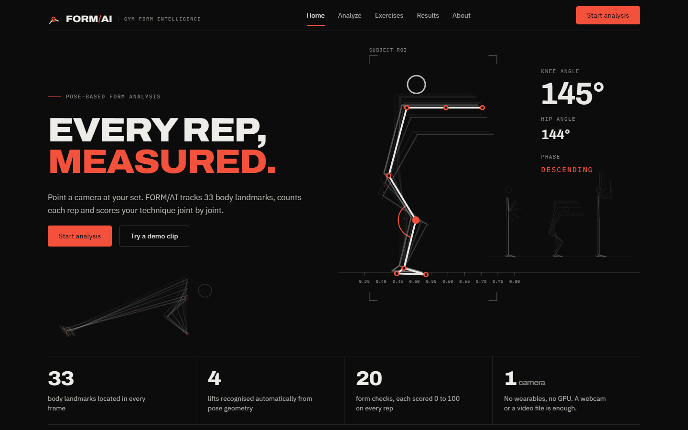
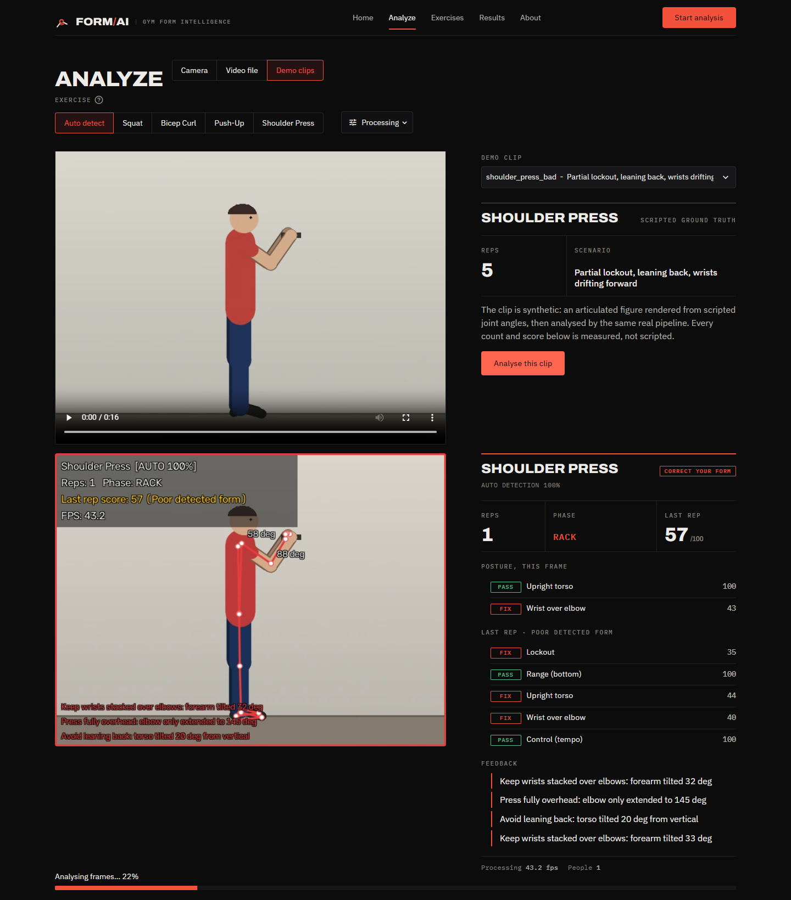
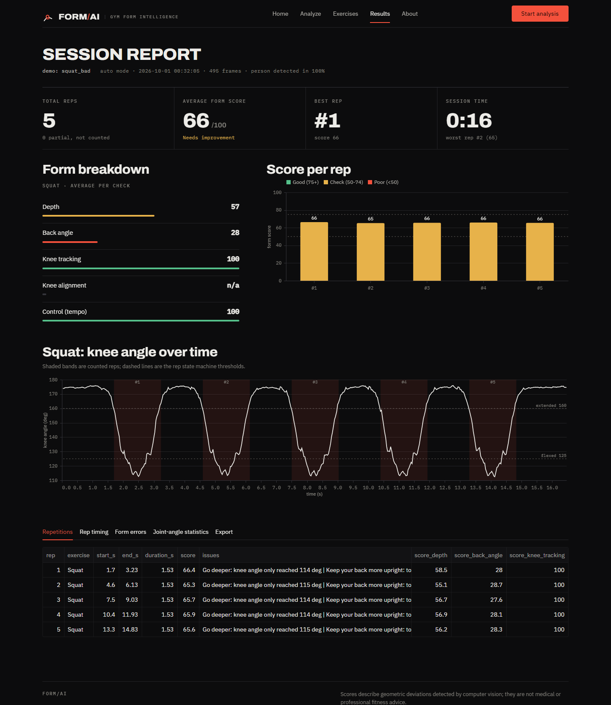
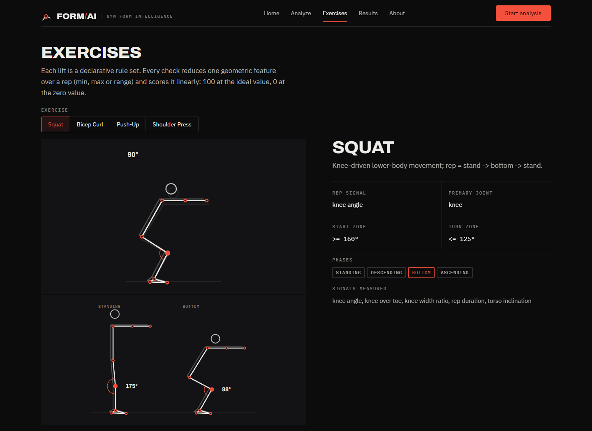
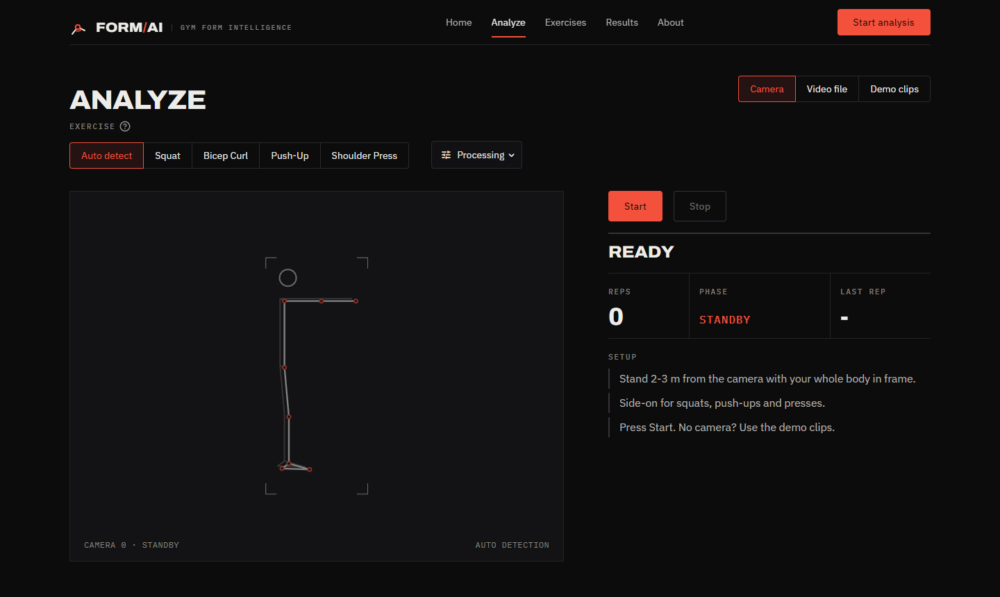
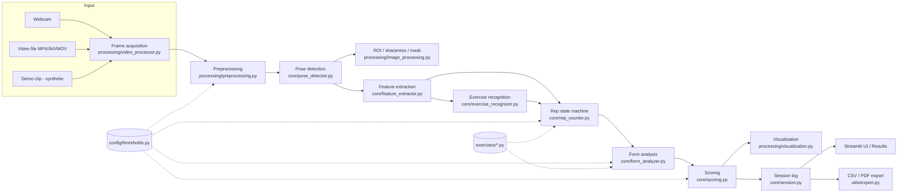
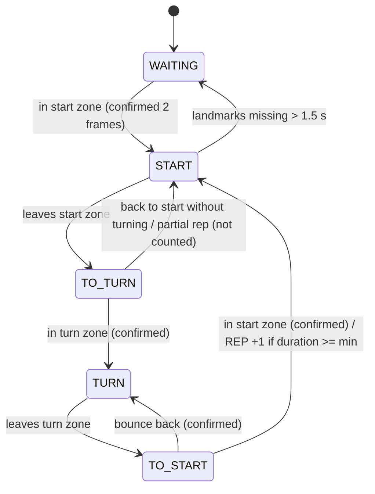

# AI-Based Gym Exercise Form Analyzer

A Digital Image Processing (DIP) and computer-vision application that analyses exercise form from a
webcam or a video file. It finds the person, extracts 33 body landmarks, computes joint angles,
recognises the exercise, counts repetitions with a hysteresis state machine, detects specific
form deviations, and gives a transparent 0–100 score with real-time visual feedback and an
exportable report. It runs on an ordinary Windows laptop CPU (no GPU).

> Scores describe geometric deviations measured by computer vision. They are **not** medical or
> professional fitness advice.



---

## Features

* **Three input sources:** live webcam, uploaded video (MP4 / AVI / MOV) and 10 scripted demo
  clips that need no camera.
* **Pose detection:** MediaPipe BlazePose, 33 landmarks per frame, with the most prominent person
  selected when several are in view.
* **Adaptive DIP preprocessing:** lighting, noise and sharpness are measured on the subject;
  CLAHE and Gaussian denoising are applied only when they are needed.
* **Automatic exercise recognition** from pose geometry, with a manual override.
* **Robust rep counting** with a hysteresis state machine (no double counts from jitter; partial
  reps reported but not counted).
* **Per-rep form analysis and scoring:** weighted, threshold-driven checks with a 0-100 score,
  a per-check breakdown and plain-language feedback.
* **Real-time feedback:** skeleton and joint-angle overlay on the video, plus a live read-out of
  reps, phase, posture checks and warnings.
* **Session report:** headline numbers, form breakdown, interactive charts (score per rep, joint
  angle over time, rep timing), tables and CSV / PDF export.
* **DIP pipeline viewer** that shows every processing stage on any frame of an uploaded video.

## Supported exercises

| Exercise | Rep signal | Phases | Checks |
|---|---|---|---|
| Squat | knee angle | standing, descending, bottom, ascending | depth, back angle, knee tracking, knee alignment, tempo |
| Bicep curl | elbow angle | arm extended, curling, top, lowering | curl height, full extension, elbow stability, torso stability, tempo |
| Push-up | elbow angle | top, lowering, bottom, pushing up | depth, lockout, hip sag, hip pike, tempo |
| Shoulder press | elbow angle | rack, pressing, lockout, lowering | lockout, bottom range, upright torso, wrist over elbow, tempo |

## Screenshots

| | |
|---|---|
|  |  |
| **Analyze:** the pipeline's annotated frame beside the live read-out (reps, phase, last score, per-check PASS / FIX, feedback). | **Session report:** headline numbers, form breakdown, score per rep and knee angle over time. |
|  |  |
| **Exercises:** each lift's scripted rep, start and turn positions with measured angles, thresholds and phases. | **Camera:** framing guide, exercise selector (auto detect or a forced lift) and processing options. |

The skeleton illustrations in the UI are not decorative artwork. They are generated in
`ui/figures.py` from the same forward-kinematics athlete that renders the demo clips, drawn with
the landmark topology of the live overlay, and annotated with angles from `core/angle_calculator`
and phases from the real rep state machine.

---

## Abstract

People training without a coach get little feedback on technique. This project turns an ordinary
camera into a form-feedback tool. Each frame goes through adaptive image preprocessing (resizing,
colour-space conversion, lighting and noise measurement, CLAHE contrast enhancement and Gaussian
denoising only when needed), pose estimation with MediaPipe BlazePose, and geometric feature
extraction (joint angles and body-proportion-normalised distances). A rule-based classifier
recognises squats, bicep curls, push-ups and shoulder presses from pose geometry. A four-state
hysteresis state machine counts repetitions without false counts from landmark jitter. Every rep
is scored against configurable per-exercise rules, and the score breakdown is shown. On 10
scripted demo clips the system counted every repetition correctly and recognised every
exercise. Under simulated poor lighting, the adaptive preprocessing raised pose detection from
0 % to about 90 %.

## Problem statement

Given a video of one person exercising, automatically determine **which exercise** is being done,
**how many repetitions** were completed and **how good the form was** in each repetition, and
explain which measurable deviations lowered the score, in real time on commodity hardware.

## Objectives

1. Detect the human body and its landmarks in webcam or video frames.
2. Compute joint angles and other geometric features from the landmarks.
3. Recognise the exercise automatically, with a manual override.
4. Count repetitions robustly (noise-tolerant state machine).
5. Detect specific form mistakes and describe them geometrically.
6. Produce a transparent, metric-driven form score.
7. Visualise everything in real time and export a report (CSV / PDF).

## Proposed solution

A modular Python pipeline (OpenCV + MediaPipe + NumPy) behind a Streamlit UI. Every stage is a
separate module, and every threshold is in one config file. Nothing in the UI is synthetic: all
values come from the processing of real frames. Demo mode uses rendered videos, but they are
analysed by the same pipeline, with MediaPipe detecting the figure.

## System architecture



`core/pipeline.py` orchestrates the stages frame by frame.

## DIP techniques used

Every operation is **measured first and applied only when needed**.

| Technique | Where | Input → output | Why it is used |
|---|---|---|---|
| Resizing with `INTER_AREA` | `preprocessing.resize_frame` | frame → frame ≤ 640 px wide | CPU speed; area interpolation low-pass filters while shrinking (no aliasing) |
| Colour-space conversion | `preprocessing` | BGR → RGB / grey / LAB | model needs RGB; statistics on grey; CLAHE on L (lightness) only |
| Grey-level statistics (mean, σ) on the subject ROI | `preprocessing.grey_statistics` | grey ROI → brightness, contrast | detect poor lighting on the *person*, not a bright background |
| Noise estimation (Immerkær) | `preprocessing.estimate_noise_sigma` | grey → σ̂ | decides whether denoising is needed |
| Gaussian low-pass filter 5×5 | `preprocessing.preprocess_frame` | noisy frame → smoothed frame | suppress sensor noise *before* CLAHE, which would amplify it |
| CLAHE (contrast-limited adaptive histogram equalisation) | `preprocessing.apply_clahe` | dark/flat frame → enhanced frame | recovers body contours in poor light |
| Laplacian edge detection (variance) | `image_processing.sharpness` | ROI → sharpness score | detects motion-blur/out-of-focus frames, warns that landmarks may be unreliable |
| Thresholding → binary mask | `image_processing.binary_person_mask` | segmentation probability → {0,255} | foreground/background separation |
| Morphological opening + closing | same | noisy mask → clean silhouette | removes specks, fills holes |
| Background suppression | `image_processing.suppress_background` | frame + mask → focused frame | optional foreground focus in the display |
| Region of interest | `image_processing.landmarks_roi` | landmarks → padded box | lighting and sharpness measured on the subject |
| Temporal filters (EMA, running median) | `feature_extractor`, `form_analyzer` | noisy angle series → smooth series | EMA reduces jitter; the median removes one-frame landmark spikes (impulse noise) |

**Measured effect of the adaptive preprocessing** (`python -m demo.dip_experiment`: pose-detection rate
on frames of `squat_good`, artificially darkened and with added Gaussian noise):

| Brightness | Noise σ | Raw | CLAHE only | Adaptive pipeline | Operations chosen |
|---|---|---|---|---|---|
| 100 % | 0 | 1.00 | 1.00 | 1.00 | none |
| 20 % | 6 | 0.91 | 0.91 | **1.00** | gaussian_denoise + clahe |
| 10 % | 0 | 0.00 | 0.89 | **0.89** | clahe |
| 10 % | 4 | 0.00 | 0.00 | **0.90** | gaussian_denoise + clahe |
| 10 % | 6 | 0.00 | 0.00 | **0.90** | gaussian_denoise + clahe |
| 6 % | 0 | 0.00 | 0.00 | 0.00 | clahe (too dark to recover) |

CLAHE alone fails on dark *and* noisy frames because it amplifies the noise. Denoising first is
what makes it work.

## Computer vision techniques

* **Pose estimation:** MediaPipe Pose Landmarker *lite* (BlazePose), 33 landmarks with visibility
  scores, run in VIDEO mode so the person is tracked between frames.
* **Multi-person handling:** up to 2 people are detected. The most prominent one (landmark-box
  area × mean visibility) is analysed, and a warning is shown. Landmarks are never mixed between
  people.
* **Geometric feature extraction:** joint angles, segment inclinations and distances normalised
  by body-segment lengths (scale-invariant).
* **View handling:** the body side facing the camera is selected, with hysteresis. A front view
  is detected from the ratio of shoulder width to torso length.

## Algorithms

### Joint angle

For points A, B (joint), C: θ = arccos( (BA · BC) / (|BA| |BC|) ), implemented as
`calculate_angle(point_a, point_b, point_c)` in `core/angle_calculator.py`, and used by every
exercise. The full derivation is in `PROJECT_DOCUMENTATION.md`.

### Exercise detection methodology

A sliding 2-second window of features gives three cues:

| Cue | Feature | Separates |
|---|---|---|
| Body orientation | median inclination of the ankle→shoulder line | push-up (horizontal) vs standing |
| Which joint moves | 5–95 percentile range of knee angle vs elbow angle | squat vs arm exercises |
| Hand height | median (shoulder_y − wrist_y) / torso length | press (hands high) vs curl |

Each exercise's score is a product of clipped linear ramps (fuzzy AND). The best score wins if it
reaches 0.5. A majority vote over the last 15 frames stops flicker. While the person rests, the
last exercise is kept. The UI clearly shows **AUTO DETECTION** or **MANUAL SELECTION**.

### Rep counting methodology

Per exercise, one joint angle drives a four-state machine:



The *start zone* is angle ≥ `extended` and the *turn zone* is angle ≤ `flexed`. For the shoulder
press, which starts flexed, the zones are swapped. The gap between the two thresholds is a
hysteresis dead band, so jitter can never produce a count. A rep must visit both zones in order,
and debouncing, a minimum rep duration and a missing-landmark timeout add further protection.

### Form analysis methodology

Each exercise is a declarative list of `FormCheck`s (see `exercises/`). A check takes one
feature over the rep window (the rest in the start position plus the movement), median-filters
it, then reduces it with **min**, **max** or **range**. Posture checks marked `live` are also
evaluated on every frame for real-time colouring.

| Exercise | Checks (feature, reduction) |
|---|---|
| Squat | depth (knee angle, min), back angle (torso inclination, max), knee tracking (knee past toes / shin, max), knee alignment (knee width / ankle width, min; front view) |
| Bicep curl | curl height (elbow, min), full extension (elbow, max), elbow stability (upper-arm swing, max), torso stability (torso inclination, range) |
| Push-up | depth (elbow, min), lockout (elbow, max), hip sag / hip pike (signed hip offset from the shoulder–ankle line) |
| Shoulder press | lockout (elbow, max), bottom range (elbow, min), upright torso (torso inclination, max), wrist over elbow (forearm from vertical, max) |
| All | control/tempo (rep duration) |

### Scoring methodology

* Check score: `s = clip((v − zero) / (ideal − zero), 0, 1) × 100`. It is 100 at the ideal value,
  0 at the "zero" value, and linear in between. The direction comes from the order of the two
  thresholds.
* Rep score: the weighted mean of the checks that could be measured. Unmeasurable checks (e.g.
  knee alignment in side view) are shown as *n/a* and excluded.
* Bands: 100 excellent · 90–99 very good · 75–89 acceptable · 60–74 needs improvement ·
  < 60 poor. Colours: green ≥ 75, yellow ≥ 50, red < 50.
* All thresholds, weights and bands are in `config/thresholds.py`.

## Requirements

* Windows 10/11 (also works on Linux/macOS), Python **3.11+** (developed on 3.14.7)
* CPU only; about 1 GB free disk for the virtual environment
* A webcam, optional (Demo Mode works without one)

## Installation

```bash
git clone https://github.com/Rebello16/ai-gym-exercise-form-analyzer.git
cd ai-gym-exercise-form-analyzer
python -m venv venv
venv\Scripts\activate            # Linux/macOS: source venv/bin/activate
pip install -r requirements.txt
```

The pose model (`models/pose_landmarker_lite.task`, 5.8 MB) is downloaded automatically on first
use, and the demo clips in `data/sample/` are rendered on first use (both are git-ignored).

## How to run

```bash
streamlit run app.py
```

Open http://localhost:8501. The server is bound to `localhost` in `.streamlit/config.toml`, so the
webcam app is not exposed to your network.

Other commands:

```bash
python -m pytest                    # full test suite (~3 min)
python -m demo.synthetic_athlete    # render all demo clips into data/sample/ up front
python -m demo.dip_experiment       # reproduce the preprocessing experiment table
```

## Usage

**Webcam:** open *Analyze* (Camera) and press **Start**. Stand 2–3 m from the camera with your whole
body visible, side-on for squats, push-ups and presses. The video shows the skeleton, joint
angles, exercise, reps, phase, last-rep score and FPS. The side panel shows the score breakdown,
feedback and warnings. Press **Stop**, or wait for the session limit, then open **Results**.

**Uploaded video:** open *Analyze* (Video file), choose an MP4/AVI/MOV file and press **Analyse video**.
Frames are processed one by one with a live preview. An annotated WebM video is saved to
`outputs/` and shown in the page. The *DIP pipeline viewer* shows every processing stage on any
chosen frame.

**Demo clips (no camera):** open *Analyze* (Demo clips) and pick one of 10 clips (good and bad form for each exercise, low light,
two people), or run **batch validation** to compare the pipeline against the scripted ground
truth.

**Navigation and settings:** the top bar switches between Home, Analyze (Camera / Video file /
Demo clips), Exercises, Results and About; `?page=<name>` deep-links a page. On the Analyze
screens the *Exercise* selector chooses auto detection or forces one exercise, and the
*Processing* menu holds processing width, frame skip, adaptive enhancement, background focus,
camera index, session length and mirror view. Settings persist across pages.

**Results:** total reps, average/best/worst rep, duration, partial reps, charts (angle vs time,
score per rep, rep duration, score breakdown), rep table, form errors, joint-angle statistics,
and downloads (report CSV, reps CSV, per-frame angles CSV, PDF report).

## Project structure

```
gym-exercise-form-analyzer/
├── app.py                        Streamlit entry point
├── requirements.txt, README.md, PROJECT_DOCUMENTATION.md, pytest.ini, .gitignore
├── .streamlit/config.toml        localhost-only server, dark theme and fonts
├── config/thresholds.py          ALL tunable numbers (processing, DIP, rep, scoring, per exercise)
├── core/
│   ├── angle_calculator.py       calculate_angle, angle_from_vertical, signed line distance
│   ├── pose_detector.py          MediaPipe Pose Landmarker wrapper, multi-person selection
│   ├── feature_extractor.py      landmarks -> features, side/view selection, EMA
│   ├── exercise_recognizer.py    rule-based recognition + vote smoothing
│   ├── rep_counter.py            hysteresis state machine
│   ├── form_analyzer.py          per-rep checks, median filter, live checks
│   ├── scoring.py                check/rep scores, bands, status colours
│   ├── pipeline.py               per-frame orchestration, warnings, logging
│   └── session.py                session log, summaries, statistics
├── exercises/                    base_exercise.py + squat, bicep_curl, pushup, shoulder_press
├── processing/
│   ├── preprocessing.py          resize, colour conversion, lighting/noise analysis, CLAHE, Gaussian
│   ├── image_processing.py       ROI, Laplacian sharpness, binary mask + morphology
│   ├── visualization.py          skeleton, angles, panel, feedback overlay
│   └── video_processor.py        video/webcam acquisition, annotated video writer
├── demo/
│   ├── synthetic_athlete.py      scripted, rendered demo clips (ground truth)
│   └── dip_experiment.py         preprocessing ablation experiment
├── ui/
│   ├── pages.py                  top navigation and every page
│   ├── components.py             settings, live read-out panel, report blocks
│   ├── figures.py                pose-skeleton SVGs generated from the scripted athlete
│   ├── charts.py                 Altair charts (UI) and Matplotlib charts (PDF)
│   └── styles.py                 design tokens and CSS
├── docs/screenshots/             README images
├── utils/                        logger.py, helpers.py, export.py (CSV / PDF)
├── models/                       pose model, downloaded on first use (git-ignored)
├── data/sample/                  demo clips, rendered on first use (git-ignored)
├── outputs/                      annotated videos, uploads (git-ignored)
└── tests/                        unit, integration and UI tests
```

**Adding an exercise:** create `exercises/<name>.py` with an `Exercise(...)` definition, add its
thresholds to `EXERCISE_THRESHOLDS`, register it in `exercises/__init__.py`, and add a cue in
`exercise_recognizer.py` if it should be auto-detected.

## Testing

`python -m pytest` runs 86 tests:

| File | Covers |
|---|---|
| `test_angles.py` | angle maths, invariances, degenerate input |
| `test_rep_counter.py` | clean reps, noise, hysteresis, partial reps, mid-rep start, missing frames, long absence, press (flexed start), minimum duration |
| `test_scoring.py` | check scores in both directions, clipping, weighting, bands, threshold validation, form analyzer, spike filtering, live checks |
| `test_exercises.py` | exercise definitions vs config, feature extraction, missing landmarks, EMA, recognition of all 4 exercises, idle/sticky behaviour, tracker state transitions |
| `test_preprocessing.py` | resize, RGB conversion, CLAHE triggering, noise estimation, denoise-before-CLAHE, sharpness, morphology, ROI |
| `test_pipeline_integration.py` | real MediaPipe on rendered clips: auto-detection + counts for all 4 exercises, bad-form detection, two people, empty video, corrupt file, exports |
| `test_app.py` | Streamlit `AppTest`: every page renders, top navigation, home buttons, source switcher, `?page=` deep links, demo analysis → report, manual mode kept across pages, missing camera |

**Validation on the demo clips** (auto detection; each clip analysed as the original WebM and
again after re-encoding to MP4):

| Clip | Expected | Counted | Detected exercise | Avg score | Flagged issues |
|---|---|---|---|---|---|
| squat_good | 5 | 5 | Squat | 100 | – |
| squat_bad | 5 | 5 | Squat | 66 | go deeper, back more upright |
| bicep_curl_good | 5 | 5 | Bicep Curl | 96 | – |
| bicep_curl_bad | 5 | 5 | Bicep Curl | 48 | curl higher, upper arm swing, torso swing |
| pushup_good | 5 | 5 | Push-Up | 95–97 | – |
| pushup_bad | 5 | 5 | Push-Up | 68–69 | lower chest, hips sagging, lockout |
| shoulder_press_good | 5 | 5 | Shoulder Press | 100 | – |
| shoulder_press_bad | 5 | 5 | Shoulder Press | 56–57 | lockout, leaning back, wrists not stacked |
| squat_low_light | 4 | 4 | Squat | 98–99 | – (CLAHE applied) |
| squat_two_people | 3 | 3 | Squat | 100 | – (2 people detected, primary analysed) |

Processing speed on the development laptop (CPU): about 40 FPS on 640×480 video, and about 30 FPS
end to end with the live webcam in the browser.

## Limitations

* Angles are measured in the 2-D image plane, so they depend on the camera viewpoint. Side view
  is recommended (front view for knee alignment).
* One subject is analysed at a time. Crowded scenes and occlusion reduce accuracy.
* Landmark accuracy drops with baggy clothing, unusual poses, extreme lighting (below about 6 %
  brightness in the experiment) or heavy motion blur. Deep elbow flexion is typically
  underestimated by the model.
* Recognition is rule-based over four exercises. Unusual variants (e.g. a sumo squat filmed from
  the front) may need MANUAL SELECTION.
* Thresholds are reasonable defaults, not clinically validated. The score measures geometry,
  not safety.
* The demo clips use a rendered figure. They validate the pipeline logic end to end, but they
  are not a substitute for real footage. Test with your own videos too.

## Future scope

* Use MediaPipe's 3-D world landmarks for viewpoint-independent angles.
* Learned recognition (e.g. an LSTM/TCN over landmark sequences) and more exercises.
* Per-user calibration of thresholds; left/right symmetry analysis.
* Audio cues and a rep-by-rep coaching timeline; mobile/edge deployment.

## References

See `PROJECT_DOCUMENTATION.md` §24.
